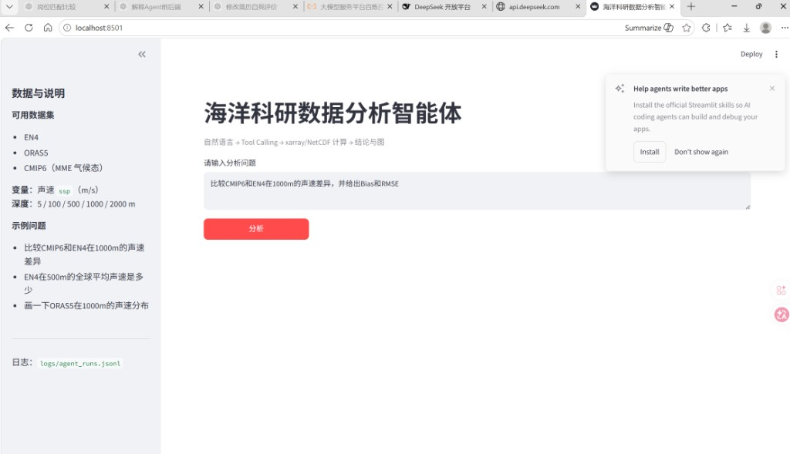
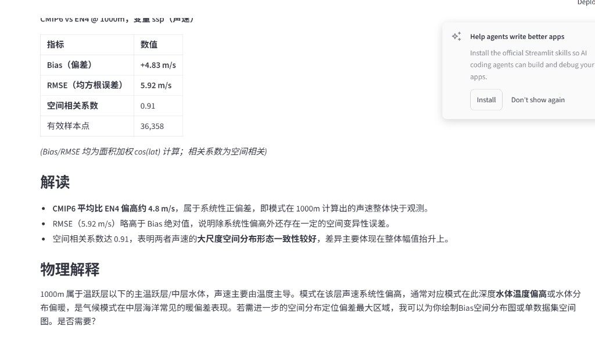

# 海洋科研数据分析智能体（Ocean Data Agent）

基于大语言模型（LLM）、Tool Calling 与检索增强生成（RAG）的海洋科研数据分析智能体，支持通过自然语言完成 NetCDF 数据查询、统计分析、模型对比、空间可视化及科研知识问答。

**🌐 [在线体验 Demo](https://ocean-data-agent-fi4iarm2xxy9rf8ahpnwz9.streamlit.app)**

**技术栈：** Python · Streamlit · DeepSeek API · Tool Calling · RAG · ChromaDB · Sentence Transformers · xarray · NetCDF4 · NumPy · Matplotlib

---

## 1. 项目概述

本项目面向海洋声速数据分析场景，将大语言模型的自然语言理解能力与 Python 科学计算工具结合，实现从用户问题到计算结果、分析结论及可视化图表的自动化处理。

系统采用 Router 进行任务路由，根据问题类型选择数值分析（Data）、知识检索（Knowledge）或混合分析（Hybrid）路径。

**核心设计思想：LLM 负责理解与推理，Python 工具负责实际数值计算，RAG 提供专业知识依据。**

## 2. 系统架构

```text
                 用户自然语言输入
                        |
                        v
                  Streamlit UI
                        |
                        v
                   Router 路由
                        |
          +-------------+-------------+
          |             |             |
          v             v             v
        Data        Knowledge       Hybrid
          |             |             |
          v             v             |
     LLM Tool Calling  RAG 检索       |
          |             |             |
          v             v             |
     Python/xarray   ChromaDB         |
          |             |             |
          v             v             |
     NetCDF 分析     知识片段召回      |
          |             |             |
          +-------------+-------------+
                        |
                        v
                 LLM 结果整理
                        |
                        v
              分析结论 / 引用 / 图表
                        |
                        v
               Streamlit 页面展示
```

系统支持多轮工具调用，能够将实际工具执行结果返回给大模型，再生成最终分析结论。

## 3. 核心功能

### 3.1 自然语言任务解析

用户通过自然语言描述分析需求，系统自动判断任务类型并选择相应执行路径。

- **Data：** NetCDF 数据读取、统计计算、模型比较及绘图。
- **Knowledge：** 基于 RAG 的海洋科研知识检索与问答。
- **Hybrid：** 结合数值分析结果和知识检索内容生成综合回答。

### 3.2 Tool Calling 数值分析

封装 Python/xarray 科学计算工具，通过大模型 Function Calling 自动选择工具并传入参数。

支持：

- 数据集变量、维度和深度信息查询
- 指定深度数据提取
- 均值、标准差、最大值和最小值计算
- 多数据集 Bias、RMSE、空间相关系数计算
- 多深度声速差异分析
- 单场空间分布和 Bias 空间分布绘图

**数值计算由 Python 工具执行，大模型不直接生成未经计算的统计指标。**

### 3.3 海洋数据处理

当前演示支持以下数据集：

| 数据集 | 类型 |
|---|---|
| EN4 | 海洋分析数据 |
| ORAS5 | 海洋再分析数据 |
| CMIP6（MME） | 多模式集合数据 |

- 主变量：`ssp`（声速，m/s）
- 样本深度：5、100、500、1000、2000 m
- 数据格式：NetCDF

项目使用小型样本数据进行功能演示。

### 3.4 RAG 科研知识问答

采用 Sentence Transformers 生成文本向量，使用 ChromaDB 构建本地向量知识库，实现专业知识检索与回答生成。

知识文档位于 `rag/knowledge/`，主要覆盖：

| 文档 | 知识主题 |
|---|---|
| `sound_channel.md` | 声道轴识别及搜索范围 |
| `interpolation.md` | PCHIP 垂向插值、WOA、TEOS-10 |
| `datasets.md` | CMIP6、EN4、ORAS5 数据集 |
| `cmip6_method.md` | Bias、RMSE 及模型评估方法 |

RAG 工作流程：

1. 读取 Markdown 知识文档。
2. 文本分块并生成 Embedding。
3. 使用 ChromaDB 存储和检索知识片段。
4. 根据用户问题召回相关内容。
5. 结合检索证据生成带来源标记的回答。

支持 Top-K 知识检索，默认使用 `top_k=4`。

云端版本支持在向量库缺失时进行初始化，首次知识问答可能需要加载或下载 Embedding 模型，因此响应时间可能较长。

### 3.5 空间可视化

使用 Matplotlib 生成科研分析图表，包括：

- 指定深度声速空间分布
- 两个数据集之间的 Bias 空间分布

示例：

`画一下CMIP6相对于EN4在1000m的Bias空间分布图`

系统解析问题后调用 `plot_bias_map`，由 Python 完成计算与绘图，再通过 Streamlit 展示生成的图片。

### 3.6 异常处理与日志追踪

系统对工具调用异常进行捕获，并记录执行状态及错误信息。

支持对深度越界、无效变量等异常请求进行反馈，避免在计算条件不满足时生成无依据的结果。

执行日志使用 `run_id` 关联分析过程，记录：

- 用户问题
- 路由类型
- 工具名称与调用参数
- 工具计算结果
- 执行耗时
- 执行状态及异常信息

相关日志模块：`logging_utils.py`。

---

## 4. 工具列表

| 工具 | 功能 |
|---|---|
| `inspect_dataset` | 查询变量、维度和深度范围 |
| `extract_depth` | 提取指定深度数据摘要 |
| `calculate_statistics` | 计算 mean、std、min、max |
| `compare_datasets` | 计算 Bias、RMSE、Correlation |
| `plot_map` | 绘制单场空间分布 |
| `plot_bias_map` | 绘制 Bias 空间分布 |

## 5. 运行示例与验证结果

### 5.1 多深度数值分析

示例问题：

**比较 CMIP6 和 EN4 在 100、500、1000、2000m 的声速差异，判断哪个深度 RMSE 最大。**

一次在线运行得到的结果如下：

| 深度 (m) | Bias (m/s) | RMSE (m/s) | Correlation |
|---|---:|---:|---:|
| 100 | +0.33 | 4.14 | 0.991 |
| 500 | +4.39 | 5.70 | 0.962 |
| 1000 | +4.83 | 5.92 | 0.913 |
| 2000 | +3.45 | 4.16 | 0.927 |

**分析结论：** 当前样本中，1000 m 深度的 RMSE 最大，约为 5.92 m/s。

Bias 与 RMSE 使用面积加权计算。上述结果基于项目演示数据，不代表对完整海洋数据产品的总体评估结论。

### 5.2 RAG 知识问答

示例问题：

`为什么声道轴搜索范围设置为100–3000m？`

系统通过 Knowledge 路由检索相关文档，生成包含参考来源标记的中文解释。

### 5.3 空间绘图

示例问题：

`画一下1000m Bias空间分布`

系统调用 `plot_bias_map` 完成数值计算与空间绘图，并在 Streamlit 页面展示结果。

### 5.4 异常请求测试

示例问题：

`比较CMIP6和EN4在9000m的声速差异，并给出RMSE。`

系统能够识别请求深度超出样本数据范围，说明无法计算的原因，不编造 RMSE，并推荐可用深度。

### 5.5 页面截图

**智能体输入界面**



**分析结果展示**



---

## 6. 项目结构

```text
ocean-data-agent/
├── app.py                 # Streamlit 页面
├── agent.py               # LLM Agent 与 Tool Calling
├── logging_utils.py       # 日志记录
├── tools/                 # 数值分析工具
│   ├── dataset_tools.py
│   ├── statistics_tools.py
│   ├── comparison_tools.py
│   ├── plot_tools.py
│   └── validation.py
├── rag/                   # RAG 知识检索
│   ├── answer.py
│   ├── embed_model.py
│   ├── ingest.py
│   ├── retriever.py
│   ├── router.py
│   └── knowledge/
├── data/                  # NetCDF 样本数据
├── eval/                  # 评估相关文件
├── docs/screenshots/      # 演示截图
├── test_tools.py          # 工具测试
├── .env.example           # 环境变量配置模板
├── .gitignore
├── requirements.txt
└── README.md
```

运行过程中还可能生成 `logs/`、`outputs/`、`rag_db/` 等目录，其中部分内容不会提交到代码仓库。

## 7. 本地运行

### 7.1 安装依赖

建议使用 Python 3.11 和独立虚拟环境。

```bash
pip install -r requirements.txt
```

### 7.2 配置模型 API

复制环境变量模板：

```powershell
copy .env.example .env
```

在 `.env` 中配置：

```dotenv
OPENAI_API_KEY=your_api_key
OPENAI_BASE_URL=https://api.deepseek.com
OPENAI_MODEL=deepseek-chat
```

项目使用 OpenAI 兼容 API，可以通过修改 Base URL 和模型名称接入相应的兼容服务。

**不要将包含真实 API Key 的 `.env` 文件提交至 Git。**

### 7.3 初始化 RAG 知识库

在项目根目录执行：

```bash
python -m rag.ingest
```

知识库会根据 `rag/knowledge/` 中的文档建立向量索引。

### 7.4 工具测试

```bash
python test_tools.py
```

### 7.5 启动 Web 应用

```bash
streamlit run app.py
```

默认访问地址：

`http://localhost:8501`

也可以使用命令行智能体：

```powershell
python agent.py 比较CMIP6和EN4在1000m的声速差异，并给出Bias和RMSE
```

## 8. 设计原则

1. **LLM 负责推理，Python 负责计算。** 数值分析基于真实工具结果，避免生成未经验证的 RMSE 等指标。
2. **Tool Calling 驱动执行。** 大模型选择函数并提供参数，Python 工具执行后将结果返回给模型。
3. **RAG 增强专业问答。** 基于知识片段提供领域背景，并在回答中保留资料引用。
4. **可观测性。** 通过日志和 `run_id` 追踪路由、工具调用、执行耗时和结果。
5. **异常处理。** 对不合法参数和工具错误进行反馈，避免失败后编造结果。
6. **领域专注。** 聚焦海洋声速 NetCDF 分析，明确数据和功能边界。

## 9. 后续规划

以下为可扩展方向，不代表当前版本已经实现：

- Planner：复杂任务的显式分解和执行规划
- Reviewer：分析结果合理性检查与重试
- Docker：容器化部署
- FastAPI：独立 API 服务接口
- 更大规模海洋数据的远程读取与分析

---

## 10. 在线体验

**🌐 [Ocean Data Agent · Streamlit Demo](https://ocean-data-agent-fi4iarm2xxy9rf8ahpnwz9.streamlit.app)**

在线 Demo 使用样本数据和云端模型 API。首次访问或模型加载可能存在等待时间，实际响应受网络和平台资源影响。